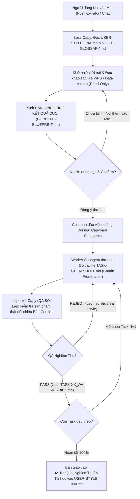

# CapyHub — Trạm Điều Phối AI Cá Nhân Hóa & Quản Lý Tài Chính Chủ Đề Capybara

<p align="center">
  
</p>

> **Triết lý vận hành (`Chill Voice, Strict QA`)**: Giống như chú Capybara điềm tĩnh với quả quýt Yuzu trên đầu, **CapyHub** giúp người dùng **Google AI Ultra** (Antigravity / Gemini CLI / Claude Code) giao tiếp bằng **Giọng nói qua Mic (Push-to-Talk)** hoặc Chat, nhưng **không bao giờ hấp tấp thực thi ngay**.
>
> Hệ thống bắt buộc đi qua **Vòng lặp Confirm Hình Dung Kết Quả Cuối (`Iterative Blueprint Gate`)** $\rightarrow$ **Chia nhỏ Task cho 6 Capybara Subagents** $\rightarrow$ **Bàn giao bằng File có YAML Frontmatter (`HANDOFF.md`)** $\rightarrow$ **Thanh tra QA chạy liên tục giữa các Task (`Maker != Checker`)** $\rightarrow$ **Tự động cập nhật Trí nhớ dài hạn (`USER-STYLE-DNA.md`)**.

---

## 1. Kiến Trúc Luồng Điều Phối Chuẩn Của CapyHub



---

## 2. Đội Hình 6 Capybara Subagents (Chuẩn YAML Frontmatter)

Toàn bộ Subagents được định nghĩa sẵn tại [`.harness-plugin/agents/`](./.harness-plugin/agents/) với bộ khung YAML Frontmatter chuẩn (`name`, `description`, `model`, `role_domain`, `handoff_schema`, `skills`):

| Nhân vật | Mã Subagent | Chuyên môn & Quy trình thực thi |
| :--- | :--- | :--- |
| **Boss Capy** | [`boss-capy-coordinator`](./.harness-plugin/agents/boss-capy-coordinator.md) | Tiếp nhận âm thanh từ Mic, khử nhiễu, lập **Bản Hình Dung Kết Quả Cuối** lặp lại tới khi người dùng đồng ý rồi mới chia task. |
| **Scribe Capy** | [`scribe-capy-wps-doc`](./.harness-plugin/agents/scribe-capy-wps-doc.md) | Xử lý văn bản trên **WPS Office** (`.docx`, `.pptx`, `.pdf`), đọc sâu tài liệu nhiều bên, chống lỗi khóa file khi WPS đang mở. |
| **Abacus Capy** | [`abacus-capy-data-analyst`](./.harness-plugin/agents/abacus-capy-data-analyst.md) | Phân tích số liệu từ Data có sẵn (`.xlsx`, `.csv`) 100% bằng script Python tất định (**0 tính nhẩm bằng LLM**). |
| **Director Capy** | [`director-capy-capcut-editor`](./.harness-plugin/agents/director-capy-capcut-editor.md) | Kết nối `capcut-mcp` tự động đọc/ghi timeline, cắt nhịp, chèn phụ đề và chạy `capcut_validate`. |
| **Treasurer Capy** | [`treasurer-capy-finance-coder`](./.harness-plugin/agents/treasurer-capy-finance-coder.md) | Phát triển và cá nhân hóa **Phần mềm Quản lý Tài chính Cá nhân (`CapyFinance`)** ngay trong Hub. |
| **Inspector Capy** | [`inspector-capy-continuous-qa`](./.harness-plugin/agents/inspector-capy-continuous-qa.md) | Thanh tra QA Độc Lập (`Maker != Checker`) chạy liên tục sau từng task hoàn thành, kiểm tra `HANDOFF.md` trước khi mở khóa task mới. |

---

## 3. Kho 7 Max Skills Đi Kèm Trong `.harness-plugin/skills/`

1. [`voice-confirm-blueprint-loop`](./.harness-plugin/skills/voice-confirm-blueprint-loop/SKILL.md): Khử nhiễu giọng nói Mic & Vòng lặp Confirm Hình Dung Kết Quả Cuối.
2. [`subagent-handoff-qa-relay`](./.harness-plugin/skills/subagent-handoff-qa-relay/SKILL.md): Chuẩn YAML Frontmatter cho `TASK-XX_HANDOFF.md` & cơ chế QA chặn giữa từng bước.
3. [`wps-multi-doc-synthesis`](./.harness-plugin/skills/wps-multi-doc-synthesis/SKILL.md): Đọc chéo tài liệu nhiều bên & xuất file WPS Office an toàn.
4. [`data-spreadsheet-insight`](./.harness-plugin/skills/data-spreadsheet-insight/SKILL.md): Phân tích số liệu tất định bằng Python & kiểm toán tổng chéo (`Cross-Footing`).
5. [`capcut-automated-editing`](./.harness-plugin/skills/capcut-automated-editing/SKILL.md): Tự động hóa dựng video CapCut qua `capcut-mcp`.
6. [`personal-finance-customizer`](./.harness-plugin/skills/personal-finance-customizer/SKILL.md): Tự động nâng cấp & tùy biến phần mềm Quản lý tài chính cá nhân theo giọng nói.
7. [`long-term-style-memory`](./.harness-plugin/skills/long-term-style-memory/SKILL.md): Trí nhớ dài hạn tự học văn phong & cách trình bày của người dùng qua nhiều phiên.

---

## 4. Hướng Dẫn Kéo Về & Sử Dụng Trong 1 Phút (Cho Bạn Bè Dùng Google AI Ultra)

### Bước 1: Clone Repo về máy cá nhân
```bash
git clone https://github.com/CnqC/capybara-ai-work-hub.git
cd capybara-ai-work-hub
```

### Bước 2: Chạy cài đặt tự động 1-Click
- **Trên Windows**: Click đúp vào file **`1-Cai-Dat-CapyHub-Lan-Dau.bat`**.
  - Script sẽ tự động tạo liên kết (`Directory Junction`) từ `.harness-plugin` vào `~/.gemini/config/plugins/capybara-work-harness`.
  - Tự động khởi tạo hồ sơ trí nhớ riêng của bạn trong `03_HoSo_TriNho_CaNhan/` (`USER-STYLE-DNA.md`, `VOICE-GLOSSARY.md`) từ bản mẫu. Các file này đã được bảo vệ trong `.gitignore` nên khi bạn bấm **`2-Cap-Nhat-Tu-GitHub.bat`** (`git pull`), **trí nhớ cá nhân và dữ liệu tài chính của bạn không bao giờ bị mất**.

### Bước 3: Mở Trạm Điều Khiển Web & Phần Mềm Tài Chính Cá Nhân (`CapyFinance`)
- Click đúp vào **`3-Mo-CapyHub-Va-App-Tai-Chinh.bat`** (hoặc chạy `npm run dev`) để mở giao diện Web Local gồm 4 phân khu:
  1. **Trạm Mic Push-to-Talk & Vòng Lặp Confirm Hình Dung Kết Quả Cuối**
  2. **Bảng Điều Phối 6 Capybara Subagents & File Bàn Giao QA Liên Tục (`HANDOFF.md`)**
  3. **Phần Mềm Quản Lý Tài Chính Cá Nhân (`CapyFinance` — Sổ cái Zero-Sum, 5 Hũ ngân sách, Quỹ mục tiêu, Xuất CSV & Tạo lệnh tự code nâng cấp)**
  4. **Trình Quản Lý Trí Nhớ Dài Hạn (`USER-STYLE-DNA.md` & `VOICE-GLOSSARY.md`)**

---

## 5. Kiểm Thử & CI/CD Tự Động

```bash
npm run doctor            # Kiểm toán kiến trúc (<250 dòng/file, 0 any, bảo mật) + Validate Harness Plugin
npm run harness:validate  # Kiểm định YAML Frontmatter của 6 Subagents & 7 Max Skills
npm run typecheck         # Kiểm tra kiểu TypeScript nghiêm ngặt
npm test                  # Chạy Vitest cho Voice Confirm Loop, XState, Handoff QA & Zero-Sum Finance
npm run build             # Đóng gói Production Bundle
```
